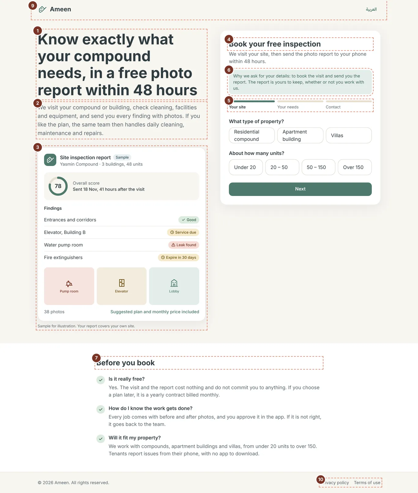
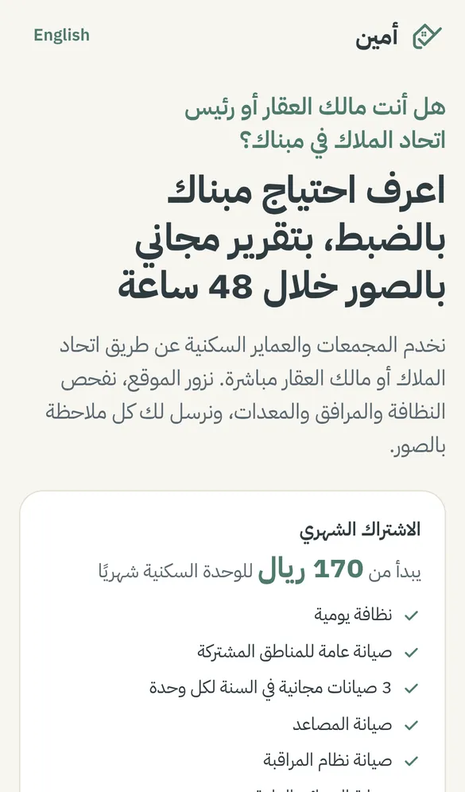
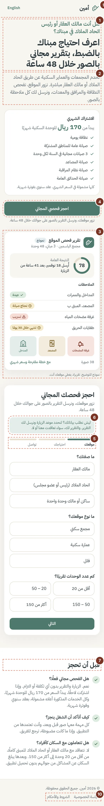

# Ameen landing page, filled-in playbook

The landing page (`/`) is built to the [Landing Page Playbook](landing-page-playbook.pdf).
This file is the playbook's "fill in for your project" worksheet for Ameen, plus the
pre-launch checklist. Update it whenever the landing page changes.

**The one rule:** if an element doesn't raise the opt-in rate of qualified leads, cut it.

| Arabic, phone (first screen) | Arabic, phone (annotated, full page) |
| --- | --- |
|  |  |

## 1. Headline

- Who is this for: the property owner or the owners' association (اتحاد الملاك) of a residential compound or building in Saudi Arabia. Ameen does not contract with individual residents or single-unit owners (Ali, 19 Nov 2026).
- Outcome they want most: know the real state of their property and get it looked after without chasing contractors.
- Headline, opening with a qualifying question (Ali's request): **"Do you own the property, or chair its owners' association? Let us help you find out what your building needs"** · «هل أنت مالك العقار أو رئيس اتحاد الملاك في مبناك؟ خلينا نساعدك في تحديد احتياج مبناك» (Ali's wording, 19 Nov 2026). The free photo report within 48 hours is stated in the CTA line and form header.

## 2. Subheadline

- Skeptic's question: "How? And then what?"
- Subheadline: "We serve residential compounds and buildings through their owners' association or the property owner. We visit, check cleaning, facilities and equipment, and send you every finding with photos."
- Price and what it includes, right under the subheadline, because a visible price qualifies leads: from 170 SAR per unit per month, including daily cleaning, general maintenance of shared areas, 3 free maintenance visits a year for each unit, elevator maintenance, security camera system maintenance and garden maintenance. Yearly contract, billed monthly.

## 3. Hero image

- Thing they get: the inspection report.
- The image shows a sample report (score, findings with status chips, photo strip, suggested plan), built in HTML in `src/app/_landing/HeroReport.tsx` so it is sharp on phones, translated, and costs no image download. It is labelled "Sample".
- Next step: replace it with a real (anonymised) report from the first pilot visit.

## 4. Call to action

- What they get: a free inspection. How: we visit, then send the photo report to their phone within 48 hours.
- Button: **"Book my free inspection"** · «احجز فحصي المجاني». One action only; the phone CTA scrolls to the form, the desktop form sits beside the headline.

## 5. Form

- Qualified lead: the property owner or owners' association of a building with shared areas (compound, building or villas), its size, its city, and the services they need.
- Fields (7): who they are, property type, number of units, services, name, mobile, city. More than 5, so 3 steps, easiest first (tap choices before typing).
- Choosing "a resident or owner of one unit" stops the form and asks them to share the page with their owner or association.
- City is required because location decides whether we can serve them.

## 6. Justification line

"Why we ask for your details: to book the visit and send you the report. The report is yours to keep, whether or not you work with us."

## 7. Objection bullets (below the fold, most common first)

1. Price and risk: "Is the inspection really free?" (also restates the 170 SAR subscription)
2. Trust: "How do I know the work gets done?"
3. Fit: "Do you work with individual residents?"

This order is a first guess. Re-rank from real sales calls and WhatsApp questions once the pilot starts.

## 8. Social proof

- Offer is high-trust (yearly contract, access to the property): yes.
- We have no real proof yet, so nothing is shown. Never invent testimonials. When the first client agrees, add their quote to `landing.proof` in `src/i18n/*.json` (`[quote, name and site]`); the section then appears below everything else. Best proof: a quote about the report or response time, matching the headline.

## 9. Design, length and speed

- Removed: navigation menu, sign-in link, second CTA, services grid, how-it-works, why-us, FAQ, closing banner, social links. (Existing users sign in at `/login` directly.)
- Kept: logo, language switch (the page must work in Arabic and English).
- Target: under 300 KB transferred and LCP under 2.5 s on a mid-range phone on 4G. Measured on a local production build: about 255 KB on phone in both languages; the hero uses no raster images.

## 10. Legal

- Pages: `/privacy` and `/terms`, linked under the form (consent wording) and in the footer.
- Regulation: Saudi PDPL. Both pages are drafts and need a lawyer's review before launch; also contact is tryameen.sa@gmail.com and Instagram @tryameen.sa (confirmed by Ali); confirm whether to show the commercial registration number.

## Pre-launch checklist

| Check | Status |
| --- | --- |
| Headline promises one clear outcome and stops the scroll | Done |
| Subheadline clarifies the promise without repeating it | Done |
| Hero image shows the thing they get or the outcome | Done (sample; swap for a real report) |
| CTA says what they get and how, with nothing else | Done |
| Only one action on the page | Done (language switch and legal links only) |
| Form asks only for what qualifies a lead | Done |
| Forms with more than 5 fields are split into steps | Done (3 steps) |
| One-line justification | Done |
| 3 objection bullets below the fold, most common first | Done (order to confirm with real data) |
| Social proof only if needed, below everything else | Slot ready, empty until real proof exists |
| Page is bare, no menus or distracting links | Done |
| Page is as short as possible | Done |
| Tested on a real phone and loads fast | Emulated iPhone 13 only; test on a real phone |
| All images compressed | Done (SVG logo only) |
| Privacy policy, terms and disclaimers linked | Done (drafts, need legal review) |
| Every element passes the one rule | Done |

| Project details | |
| --- | --- |
| Project | Ameen (أمين) |
| Page URL | `/` on the Ameen app |
| Launch date | To set |
| Opt-in rate (qualified leads) | Track from `/admin/leads` against page visits |
